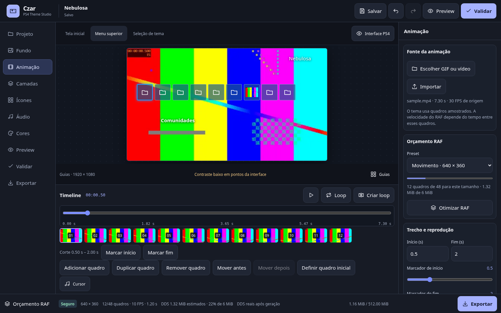

# Czar PS4 Theme Studio

Editor web em português brasileiro para criar e validar temas estáticos e animados
de PlayStation 4. O navegador do tablet controla o canvas e a timeline. O servidor
Linux faz a análise, composição, codificação e exportação.



[Veja a captura em portrait](docs/studio-portrait.png).

## Começar no GitHub Codespaces

1. Abra um Codespace neste repositório e aguarde a instalação do devcontainer.
2. No terminal, execute `./start.sh`.
3. No painel **Portas**, abra a porta **8000** no navegador. Confirme a visibilidade **Privada** e entre na mesma conta GitHub no tablet.

O endereço encaminhado segue `https://<nome-do-codespace>-8000.<domínio-de-encaminhamento>`,
normalmente `app.github.dev`. O script imprime a URL quando as variáveis de
Codespaces estão presentes. A API `/healthz` verifica a disponibilidade de FFmpeg e ffprobe.

Em Linux local, instale Python 3.11+, FFmpeg e ffprobe e execute
`python -m pip install -r requirements.txt` seguido de `./start.sh`.
Abra `http://127.0.0.1:8000`.

## Criar um tema

- Crie um tema e escolha fundo estático ou animado. Importe mídias pelo seletor Android e reutilize os originais na biblioteca do projeto.
- No canvas, arraste com toque ou caneta para mover o fundo. Os controles de posição, enquadramento e recorte também funcionam por teclado.
- Ajuste o trecho, o playhead e o orçamento em **Animação**. Ative o modo **Avançado** em **Projeto** para escolher tempos individuais, editar o enquadramento da animação e ajustar metadados.
- Em **Camadas**, use imagens estáticas, o primeiro quadro de GIFs ou cores sobre a fonte principal. A composição é renderizada antes do DDS.
- Configure ícones, áudio e cores. Use as três telas de preview e o teste de contraste por amostragem.
- Valide e exporte o ZIP de sua escolha. Exporte o projeto com os originais para reabri-lo em outro navegador ou servidor.

Projetos são gravados em `workspace/projects/<id>/`, com manifesto JSON de schema 1.
O autosave faz gravação atômica e detecta conflitos entre abas. A sessão persistente
do navegador identifica o proprietário. Cookies apagados, outros perfis ou outro
domínio exigem importar um ZIP para recuperar o projeto nesses ambientes. Codespaces
pode apagar seu armazenamento quando um Codespace for excluído.

## Upload retomável no tablet

A partir da correção 0.1.1, os arquivos são enviados em blocos de **512 KiB**, com
até cinco tentativas por requisição em erros temporários. O navegador calcula
o **SHA-256 do arquivo original** e o servidor verifica a integridade após
reconstruí-lo. O upload não modifica nem recomprime os vídeos.

Se a conexão cair ou você tocar em **Pausar importação**, abra o mesmo projeto,
escolha **o mesmo arquivo no tablet** (nome, tamanho e data de modificação)
e o envio continuará do deslocamento confirmado pelo servidor. Sessões
incompletas expiram após 24 horas. O limite continua sendo 128 MiB por
arquivo e 512 MiB por projeto. Somente a importação está sendo alterada;
a exportação RAF ainda depende de seus próprios limites.

Para testar as rotas e a retomada:
```bash
python tests/make_fixtures.py
python -m unittest discover -s tests -p 'test_chunked_upload.py' -v
```

## Mídia e formatos

Aceita PNG, JPEG, WebP, BMP e GIF, além de MP4/MOV modernamente encapsulados, WebM,
WAV, MP3, AAC/M4A, OGG/Opus, FLAC, AT9 e VAG válidos. O tipo é identificado a partir
do conteúdo. O Studio limita a mídia a 4096 px por eixo, 9,4 MP por quadro e 300 s.

O fundo estático é renderizado em 1920 × 1080. No modo animado, a cena cobre a
tela inicial e o menu superior. O Studio preserva a imagem do tema como
capa e usa um quadro da fonte quando não há capa escolhida.

| Preset RAF | Resolução | Máximo |
| --- | --- | --- |
| Qualidade | 1280 × 720 | 13 quadros |
| Equilibrado | 960 × 540 | 24 quadros |
| Movimento | 640 × 360 | 48 quadros |

A cena usa DXT1a, `plane.mdx` e `index.xml` com `wait` em segundos decimais.
A duração do loop resulta do número de quadros multiplicado por `wait`.
O limite é de 48 quadros e 6 MiB de DDS, conforme o projeto original.
O FPS da fonte descreve a mídia de entrada. O FPS RAF depende do intervalo de reprodução.

Os efeitos de cursor, confirmar e cancelar são convertidos para VAG mono a 48 kHz.
Para música personalizada, importe ATRAC9 a 48 kHz, aproximadamente 144 kbps e
loop completo. Outras faixas são exportadas em WAV estéreo PCM 16 bits a 48 kHz
para conversão externa. Ganho e fades são aplicados na preparação do WAV ou VAG.
O preview toca até os primeiros 30 segundos do trecho musical.

## Exportação e empacotamento

- **Projeto** inclui o manifesto e as mídias originais.
- **Assets processados** inclui os recursos convertidos e o relatório.
- **Cena RAF** preserva `scene/background.raf/` e os nomes esperados.
- **Árvore** inclui `Image0/` e `Sc0/`.
- **Bundle** acrescenta `theme.gp4`, manifesto, hashes e instruções.
- **Diagnóstico** inclui manifesto e relatórios sem mídia original.

**Status C — bundle pronto para empacotamento externo.** O servidor gera a
árvore, `param.sfo` e GP4, com `volume_type=pkg_ps4_theme`, `IRO_TAG=2` e
`CATEGORY=ac`. O empacotamento precisa ser feito em um ambiente compatível
com ferramentas fornecidas pelo proprietário. Use
`python tools/verify_bundle.py bundle-empacotamento.zip` para verificar o ZIP
antes de entregá-lo à etapa de empacotamento. A verificação cobre o inventário e
a integridade do bundle. O `EMPACOTAMENTO.md` no ZIP descreve a etapa externa.

A base original é [MIT](LICENSE). FFmpeg segue a licença da compilação instalada
e sua configuração aparece em **Licenças e componentes**. Ferramentas Sony
têm licença própria e são opcionais apenas fora do Studio Linux.

## Teste físico

No painel **Validar**, associe um registro ao Build ID. O alvo padrão é PS4 Slim
com firmware 12.52. Registre instalação, listagem, aplicação, RAF, música, SFX,
ícones, reinicialização, código CE e observações. Nenhuma validação estrutural
substitui o teste no console. O relatório mantém a etapa de pacote como não
verificável enquanto o ambiente só exportar bundles.

## Arquitetura e segurança

- `app/studio/` contém API, schema, storage, mídia, fila, composição, PSF e validação.
- `app/static/studio/` contém módulos JS sem bundler. O preview compõe miniaturas e quadros de baixa resolução.
- O servidor usa um processo Uvicorn e uma fila limitada, com cancelamento entre etapas, logs e retenção dos seis jobs mais recentes por projeto.
- Os projetos são isolados pela sessão. O servidor valida origem, CSRF, UUIDs, tipos, cotas, tamanho e caminhos ZIP. FFmpeg usa argumentos fixos, contêineres reconhecidos e timeout.
- Valores padrão de `CZAR_UPLOAD_BYTES` e `CZAR_PROJECT_BYTES` são 128 MiB por arquivo e 512 MiB por projeto. `CZAR_WORKSPACE` muda a raiz privada de armazenamento.
- Mantenha o encaminhamento como privado. O servidor foi projetado para um Codespace privado, com a autenticação do GitHub na borda.
- O editor original permanece disponível localmente pelo `run.ps1` ou pela opção `CZAR_LEGACY=1` restrita à interface de loopback. Ele usa o armazenamento legado.

## Testar

```bash
python -m pip install -r requirements.txt -r requirements-dev.txt
python -m playwright install --with-deps chromium
./test.sh
```

`./test.sh api`, `./test.sh ui` e `./test.sh legacy` selecionam suítes.
Pare aplicações nas portas de teste 8000 e 8174 antes de iniciar.
`CZAR_CHROMIUM` seleciona o executável em todos os testes de interface. As suítes de
interface usam viewports touch de tablet em landscape e portrait. Os testes
originais de PKG/AT9 cobrem os ramos disponíveis sem as ferramentas e só exercitam
a construção quando as dependências legítimas estão presentes.

[Auditoria e baseline](docs/auditoria.md) · [Changelog](CHANGELOG.md)

## Solução de problemas

- **Porta não abre** — confirme `./start.sh`, o painel Portas e a sessão GitHub no tablet. Teste `/healthz`.
- **Quadro indisponível no final do vídeo** — recue o marcador de fim ou confirme que o clipe possui quadros decodificáveis nesse trecho.
- **Orçamento RAF excedido** — reduza quadros, escolha uma resolução menor ou ajuste o FPS efetivo.
- **Sem música no tema exportado** — se o bundle contém WAV, a conversão ATRAC9 e a reimportação estão pendentes.
- **Sem projeto na lista** — entre no mesmo domínio e perfil de navegador ou importe o ZIP do projeto.

## Limitações desta versão

O preview é uma simulação visual com amostras, sem validação no hardware.
As camadas animadas múltiplas, crossfade, amostragem por movimento, edição de
texto, mascaramento avançado e PWA ficam fora desta versão. A prévia pode
demorar no primeiro carregamento dos quadros. O hardware Galaxy Tab S10 Ultra
e o PS4 12.52 exigem teste físico à parte.
