# Ouroboros Cinematic Deluxe · Documentação Técnica

## 1. Arquitetura do Supreme Motion Engine

O **Ouroboros Cinematic Deluxe** estende o Czar PS4 Theme Studio de forma **100% aditiva**, preservando intactas as rotas originais (`/api/ouroboros/*`), os encoders canônicos (`app/dxt1.py`, `app/dds.py`, `app/mdx.py`, `app/raf.py`, `app/theme.py`) e os manifests de projeto (`schemaVersion: 1`).

```mermaid
flowchart LR
    A["Fonte MP4/GIF/MOV"] --> B["Sentinela Supreme (Níveis A–E)"]
    B --> C["Círculo Supreme (9 custos · 5 categorias)"]
    C --> D["Reconstrução (Escada 6 níveis + Gênesis 2D)"]
    D --> E["Cinematic Content Editor (Máscaras Regionais)"]
    E --> F["CZAR Temporal Calibrator (25–150 ms)"]
    F --> G["Ouroboros Deluxe Finish (Lab · Anti-flicker · Dither)"]
    G --> H["DDS DXT1a Canônico (Encode → Decode)"]
    H --> I["Validação Científica (16 Métricas Pós-DDS)"]
    I --> J["Aplicação Transacional + RAF Equivalente"]
```



### Módulos criados sob `app/deluxe/`

| Módulo | Responsabilidade |
| --- | --- |
| `app/deluxe/flow.py` | Optical flow denso bidirecional (Farneback/DIS), checagem de consistência frente/trás (Sundaram), mapa de oclusão e confiança, correlação de fase subpixel e estimação de câmera via RANSAC/LK |
| `app/deluxe/metrics.py` | Suíte científica de 16 métricas circulares (`F[N-1] → F[0]` vs distribuição interna), detecção de banding DXT1a, avaliação obrigatória pós-DDS em resolução nativa e matriz antes/depois com rejeição de regressões |
| `app/deluxe/sentinela_supreme.py` | Análise progressiva em 5 níveis (A: exploração global + VFR, B: segmentação regional orientada a velocidade, C: cinemática/oclusão/câmera/subpixel, D: periodicidade real vs simetria/pulsação/repetição espacial, E: diagnóstico por orçamento RAF) |
| `app/deluxe/circulo_supreme.py` | Busca em toda a duração com função de custo multicritério de 9 termos calibrada contra a distribuição interna, penalidade de micro-duração e emissão das 5 categorias nomeadas com receitas reproduzíveis |
| `app/deluxe/genesis_supreme.py` | Síntese periódica progressiva 2D em máscaras livres: wrap periódico 2D exato ou advecção Euleriana dual-phase unidirecional (com duas camadas de referência para N quadros DDS distintos e blend multibanda preservador de contraste — zero ping-pong) |
| `app/deluxe/reconstructor.py` | Escada de reconstrução de 6 níveis: corte natural → harmonização fotométrica CIE Lab → compensação de fluxo frente/trás com gate de confiança/oclusão → ponte de peças-chave de transição do próprio conteúdo (seam DP + pirâmide Laplaciana) + estabilização + remoção de transitórios → textura dinâmica → composição multirregião independente |
| `app/deluxe/regions.py` | Modelo Pydantic de edição regional (`rect`, `ellipse`, `polygon`, `brush` add/erase em coordenadas normalizadas), 5 estratégias (`protect`, `animate`, `remove_transient`, `fix_seam`, `adjust_motion`), mapa visual de diferenças e persistência atômica por projeto |
| `app/deluxe/calibrator.py` | Varredura dos intervalos canônicos `wait` (`25`, `33,333`, `40`, `50`, `66,667`, `75`, `100`, `125`, `150` ms) respeitando a velocidade natural da fonte e emitindo 5 recomendações separadas |
| `app/deluxe/finish.py` | Acabamento cinematográfico sobre a sequência exportada: anti-flicker seletivo, harmonização Lab, guarda de nitidez e dither ordenado Bayer 4×4 temporalmente estático em gradientes, com rejeição automática de qualquer etapa que piore o resultado após DDS DXT1a |
| `app/deluxe/pipeline.py` | Orquestração fim a fim, montagem do `background.raf.zip` canônico e aplicação transacional com rollback seguro ao projeto ativo |
| `app/deluxe/router.py` | Rotas aditivas `/api/ouroboros/deluxe/*` (análise, calibração, renderização, receitas regionais, artefatos e aplicação) |

---

## 2. Dependências, Versões e Licenças Auditadas

| Pacote | Versão verificada | Licença | Justificativa técnica |
| --- | --- | --- | --- |
| `fastapi` | 0.165.0 | MIT | Servidor API existente |
| `uvicorn` | 0.54.0 | BSD-3-Clause | Servidor ASGI existente |
| `python-multipart` | 0.0.34 | Apache-2.0 | Upload multipart existente |
| `numpy` | 2.5.5 | BSD-3-Clause | Tensores, DXT1a e álgebra vetorizada |
| `pydantic` | 2.14.4 | MIT | Validação estrita de schemas e receitas |
| `Pillow` | 13.0.0 | MIT-CMU | Imagens, WebP lossless e composição raster |
| `opencv-python-headless` | 5.1.0.95 | Apache-2.0 | Optical flow Farneback/DIS, LK, RANSAC afim, `remap`, pirâmides Laplacianas, `inpaint`, CIE Lab em CPU |
| `scipy` | 1.18.1 | BSD-3-Clause | Suporte numérico e processamento de sinais |
| `scikit-image` | 0.26.0 | BSD-3-Clause | SSIM / MS-SSIM perceptual |
| `FFmpeg` / `FFprobe` | 5.1.9-0+deb12u1 | LGPL/GPL (binário sistema) | Decodificação, extração temporal, timestamps VFR e codificação lossless |
| `pytest` / `playwright` / `httpx` | 9.2.0 / 1.65.2 / 0.28.1 | MIT / Apache-2.0 / BSD-3-Clause | Dependências apenas de desenvolvimento e testes |

**Modelos neurais (PyTorch / RAFT / RIFE):** não incorporados como dependência obrigatória. A solução clássica vetorizada em CPU atende integralmente os cenários A–R e os vídeos reais sem exigir GPU nem gigabytes de pesos.

---

## 3. Métricas Científicas e Validação Pós-DDS

Cada sequência renderizada passa obrigatoriamente por:
`render → codificação DDS DXT1a canônica → decodificação DDS → avaliação das 16 métricas em resolução nativa`.

As 16 dimensões medidas comparam a junção `F[N-1] → F[0]` contra a distribuição interna (`F[i] → F[i+1]`):
1. Similaridade visual (MAE, PSNR, SSIM, MS-SSIM, `seamRatio`, `seamZScore`, `localSeamExcess` em grade 8×8)
2. Continuidade de fluxo óptico (erro vetorial, cosseno direcional, fração oposta, oclusão frente/trás)
3. Continuidade de velocidade
4. Continuidade de aceleração (2ª derivada vetorial)
5. Continuidade de luminância (`Lab L*`)
6. Continuidade cromática (`Lab a*, b*`)
7. Consistência estrutural e de bordas (Sobel + `localEdgeExcess` 8×8)
8. Flicker (oscilação alternada de alta frequência — distingue pulsação natural suave de flicker artificial)
9. Ghosting (queda localizada de nitidez + assinatura de mistura linear entre vizinhos — não confunde motion blur uniforme com ghosting)
10. Preservação de nitidez e textura (variância Laplaciana relativa à referência)
11. Integridade de regiões estáticas/protegidas (alinhadas a blocos 4×4 DXT1)
12. Artefatos de reconstrução (bordas pretas/vazias, foldover de Jacobiano do fluxo, índice de banding)
13. Reversões / ping-pong (simetria espelhada + fluxo oposto em área estrutural real)
14. Congelamentos e quadros duplicados
15. Regularidade de cadência (CV de deslocamento e jitter de timestamps)
16. Delta pós-DDS DXT1a (PSNR, SSIM, MAE, orçamento exato em bytes, validade de cabeçalho FourCC `DXT1`, aumento de banding e quadros distintos)

---

## 4. Métodos Experimentais e Limitações Conhecidas

- **Advecção Euleriana dual-phase (`genesis_supreme.py`):** funciona muito bem para água, rios, nuvens, névoa e atmosferas contínuas com fluxo coerente, mantendo progressão estritamente unidirecional e N quadros distintos. Não é adequada a objetos rígidos articulados (ex.: pessoas caminhando ou rosto girando) — nesses casos o motor recusa a síntese ou recomenda outro caminho.
- **Ponte de peças de transição (`reconstructor.py` Nível 4):** exige margem de origem (`lead_in` ou `lead_out`) para extrair peças reais do conteúdo; quando não há margem ou a confiança do fluxo é baixa (`< 0,35`), o warping é desativado seletivamente para evitar distorção.
- **Remoção de objeto transitório (`remove_transient_region`):** baseada em placa mediana temporal + inpainting Telea. Funciona bem quando o objeto cruza rapidamente um fundo relativamente estável; objetos que permanecem parados na maior parte da janela deixam rastro maior.
- **`libvmaf` indisponível no FFmpeg da VM:** avaliação perceptual usa SSIM, MS-SSIM, PSNR, gradientes, fluxo, flicker, ghosting e banding próprios em CPU.
- **`flower.mp4` (Cenário S):** não presente no repositório, histórico Git ou issues. A suíte aceita qualquer vídeo privado via `CZAR_ACCEPTANCE_VIDEO`.
- **Teste físico no PS4 Slim 12.52 e no Galaxy Tab S10 Ultra real:** pendente de execução física pelo proprietário (a suíte Playwright validou toque emulado em 1480×924 e 924×1480 no Chromium).

---

## 5. Resultados Comparativos e Benchmarks (Medidos em CPU Linux · 2 vCPUs Intel Xeon Platinum 8481C · Python 3.12.16)

| Caso / Fonte | Estratégia / Etapas | Tempo (wall / CPU) | Antes (pós-DDS) | Depois (pós-DDS) | Orçamento DDS real |
| --- | --- | ---: | --- | --- | ---: |
| `lua-sintetica.mp4` (640×360, 12q) | `level6_multi_region` (auto) | Análise 0,92 s · Render+Finish 16,56 s (18,67 s CPU) | MAE junção `6,478` · SSIM `0,898` · custo `53,08` | MAE junção `1,948` · SSIM `0,978` · custo `2,75` | `1.383.936 B` (ZIP `104.947 B`) |
| `tests/sample.mp4` (7,3 s) | Sentinela Supreme + Calibrador (15 configs) | Análise 10,01 s · Calibração 15,81 s | Classificação: `INADEQUADO` (sem falso positivo) | 15 configurações avaliadas por orçamento | — |
| Cenário D · quase-periódico (640×360, 16q) | `level5_dynamic_texture_synthesis` + Finish | 19,81 s wall / 20,63 s CPU | `seamDeltaL -5,426` · MAE `17,911` | `seamDeltaL +0,021` · MAE `14,783` | `1.845.248 B` (encode `972,6 ms`) |
| Cenário H2 · flicker artificial (640×360, 16q) | `selective_anti_flicker`, `photometric_lab_harmonize` | 16,84 s wall / 16,26 s CPU | Flicker `31,267` | Flicker `6,521` (**−79,1%**) | `1.845.248 B` (encode `1.145,2 ms`) |
| Cenário K · estático+dinâmico (960×540, 24q) | Gênesis Supreme 2D (máscara protegida) | 15,12 s wall / 14,84 s CPU | Região protegida verificada pós-DXT1a | `maxAbsDiff = 0,0` · `24/24` quadros distintos | `6.223.872 B` (98,9% do teto 6 MiB) |

- **Pico de RAM RSS acumulado na suíte de benchmarks:** `1.039,1 MiB` (inclui múltiplos renders 640×360 e 960×540 no mesmo processo; em operação normal por job, uso fica na faixa de ~220–450 MiB).
- **Codificação DDS DXT1a paralela (`dds.encode_sequence` em 2 vCPUs):** ~`37–60 ms/quadro` em 640×360 e ~`85–155 ms/quadro` em 960×540 (dependendo de contenção de CPU), mantendo saída **byte-a-byte idêntica** ao encoder nativo canônico.

---

## 6. Como Reproduzir os Testes

```bash
# 1. Preparar ambiente (Python 3.12 + dependências)
python -m pip install -r requirements.txt pytest httpx playwright
python tests/make_fixtures.py

# 2. Suíte científica completa do Ouroboros Deluxe (Checkpoints 1 a 5 · Cenários A–R)
PYTHONPATH=. pytest tests/test_deluxe_checkpoint1.py tests/test_deluxe_checkpoint2.py tests/test_deluxe_checkpoint3.py tests/test_deluxe_checkpoint4.py tests/test_deluxe_checkpoint5.py -v

# 3. Regressões da Fundação, Gênesis V1, Compositor, Projetos, Biblioteca e Equivalência 8a9ef7f
PYTHONPATH=.:tests python -m unittest test_sentinela test_circulo test_genesis test_ouroboros_api test_ouroboros_compat test_projects test_library test_compositor -v
python tests/test_dxt1.py

# 4. Testes de toque em Chromium (paisagem 1480×924 e retrato 924×1480)
CZAR_CHROMIUM=/usr/bin/chromium PYTHONPATH=.:tests python tests/test_deluxe_browser.py
CZAR_CHROMIUM=/usr/bin/chromium PYTHONPATH=.:tests python tests/test_ouroboros_browser.py
CZAR_CHROMIUM=/usr/bin/chromium PYTHONPATH=.:tests python tests/test_genesis_browser.py

# 5. Benchmarks de desempenho e qualidade pós-DDS
PYTHONPATH=. python tests/bench_deluxe.py
```

---

## 7. Roteiro de Aceitação Visual no Galaxy Tab S10 Ultra

1. Iniciar o servidor no Codespace via `./start.sh` na branch `feature/czar-ouroboros-deluxe-antigravity-v1` e abrir a porta privada `8000` no Chrome do Galaxy Tab S10 Ultra.
2. Criar um projeto no editor, importar um vídeo (ex.: `docs/examples/genesis/lua-sintetica.mp4` ou vídeo real privado) e abrir **Diagnóstico de loops** (Ouroboros Cinematic Deluxe).
3. Tocar em **Diagnóstico Supreme (A–E)** e conferir a classificação por resolução e as categorias encontradas pelo Círculo Supreme.
4. Ajustar início/fim na timeline e tocar em **Calibrar cadência (25–150 ms)**; escolher uma recomendação (ex.: *Melhor equilíbrio* ou *Melhor fluidez*).
5. No **Cinematic Content Editor**, desenhar por toque uma máscara de proteção sobre a área estática (ex.: lua/montanha), testar **Desfazer / Refazer** e tocar em **Salvar receita no projeto**.
6. Manter **Ouroboros Deluxe Finish + validação pós-DDS** ativo e tocar em **Renderizar loop Deluxe + validar DDS**.
7. Observar **10 voltas completas** na prévia dos DDS decodificados; verificar na telemetria se eventuais engasgos são do navegador (`saltos rAF`) e inspecionar **último → primeiro** e **Antes / Depois / Mapa de diferenças**.
8. Tocar em **Aplicar ao tema do projeto**, aguardar confirmação do servidor, voltar ao editor, recarregar a página (e reiniciar o Uvicorn) para confirmar persistência e exportar `background.raf.zip`.
9. Testar o tema empacotado no PS4 físico antes de aprovar integração por merge.
